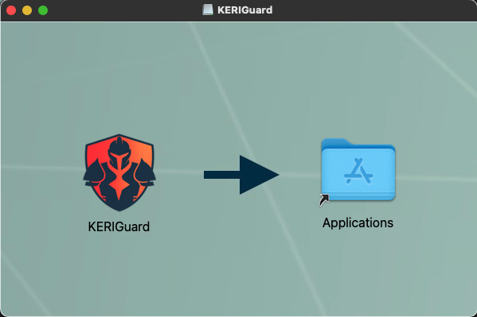

<Info>
  **Prerequisites**: Please see [Environment](/environment) before proceeding. <br />
</Info>

Follow these steps to install and run our tutorials on your operating system:


### Download and Install

**Step 1**: Install KERIGuard Identity Manager (KIM):

KERIGuard Identity Manager (KIM) is our [KERI](/essentials/overview) identity wallet and secure web proxy GUI.  We currently have installable versions for macOS (arm64) and Windows 11 PCs.  To use any other operating system, you can download our Python Wheel and install as described below

(Other native installers will be available shortly)

<Tabs>
    <Tab title="macOS">
        ```bash Shell
        curl -s -L -o KERIGuard.dmg https://healthkeri-deployment.sfo3.digitaloceanspaces.com/keriguard-identity-manager/current/MacOS/KERIGuard.dmg
        ```

        Or you can download [KIM for macOS](https://healthkeri-deployment.sfo3.digitaloceanspaces.com/keriguard-identity-manager/current/MacOS/KERIGuard.dmg) directly.

        Locate `KERIGuard.dmg` in Finder, double click and drag the KERIGuard Icon into Applications folder.
        

    </Tab>
    <Tab title="Windows">
        ```bash Shell
        curl -s -L -o KERIGuardSetup.exe https://healthkeri-deployment.sfo3.digitaloceanspaces.com/keriguard-identity-manager/current/Windows/KERIGuardSetup.exe
        ```

        Or you can download the [KIM installer for Windows](https://healthkeri-deployment.sfo3.digitaloceanspaces.com/keriguard-identity-manager/current/Windows/KERIGuardSetup.exe) directly.

        Locate `KERIGuardSetup.exe` in Windows Explorer and double click it to run the installer, then launch KERIGuard when it completes.

        For managed or silent enterprise deployments, an [MSI installer](https://healthkeri-deployment.sfo3.digitaloceanspaces.com/keriguard-identity-manager/current/Windows/KERIGuardSetup.msi) is also available:

        ```bash Shell
        curl -s -L -o KERIGuardSetup.msi https://healthkeri-deployment.sfo3.digitaloceanspaces.com/keriguard-identity-manager/current/Windows/KERIGuardSetup.msi
        ```

    </Tab>
    <Tab title="Python">
        If you are using an operating system other than macOS, you need to use the correct version of Python specified [here](/environment):

      <CodeGroup>

      ```bash macOS / Linux
      python -m venv ./kim
      source ./kim/bin/activate
      curl -s -L -o rack-1.3.0-py3-none-any.whl https://healthkeri-deployment.sfo3.digitaloceanspaces.com/rack/rack-1.3.0-py3-none-any.whl
      curl -s -L -o KIM-py3-none-any.whl https://healthkeri-deployment.sfo3.digitaloceanspaces.com/keriguard-identity-manager/current/KIM-py3-none-any.whl
      pip install rack-1.3.0-py3-none-any.whl
      pip install KIM-py3-none-any.whl
      ```

      ```powershell Windows (PowerShell)
      python -m venv .\kim
      .\kim\Scripts\Activate.ps1
      curl.exe -s -L -o rack-1.3.0-py3-none-any.whl https://healthkeri-deployment.sfo3.digitaloceanspaces.com/rack/rack-1.3.0-py3-none-any.whl
      curl.exe -s -L -o KIM-py3-none-any.whl https://healthkeri-deployment.sfo3.digitaloceanspaces.com/keriguard-identity-manager/current/KIM-py3-none-any.whl
      pip install rack-1.3.0-py3-none-any.whl
      pip install KIM-py3-none-any.whl
      ```

      </CodeGroup>

        <Info>**Recommended:** We recommend using a unique Python virtual environment as detailed above.</Info>
    </Tab>
</Tabs>

**Step 2**: Clone the healthKERI [rack-docker](https://github.com/healthKERI/rack-docker) repository:

<CodeGroup>

```bash Git
git clone https://github.com/healthKERI/rack-docker.git
cd rack-docker
```
</CodeGroup>

<Note>
    **Note**: Please see this [Guide](https://docs.github.com/en/enterprise-server@3.13/desktop/overview/getting-started-with-github-desktop) for using GitHub Desktop instead of the command line. <br />
</Note>


### Launching KIM

If you downloaded one of our native installers for [KIM](#download-and-install) please use your Operating System to find and launch the application.

If you installed the Python wheel in a virtual machine, you can launch KIM with the following command:

<CodeGroup>

```bash macOS / Linux
source ${PATH_TO_VENV}/bin/activate
python -m locksmith.main
```

```powershell Windows (PowerShell)
& "$PATH_TO_VENV\Scripts\Activate.ps1"
python -m locksmith.main
```

</CodeGroup>

<Note>The Python wheel does not install a dedicated launch command, so start KIM by running its `locksmith.main` module as shown above.</Note>

KIM will attempt to create database files in one of two directories.  If you have a directory named `/usr/local/var/keri` and the current user has write access to that directory it will create all database files and keystores at that location.
Otherwise, it will create and use a directory named `.keri` in the current user's home directory.  If you want to back up your KERI identity information and your keystore, you can back up which ever of these two directories is created on your device.


For more information see the [KERI Python Reference Implementation](https://github.com/WebOfTrust/keripy).
